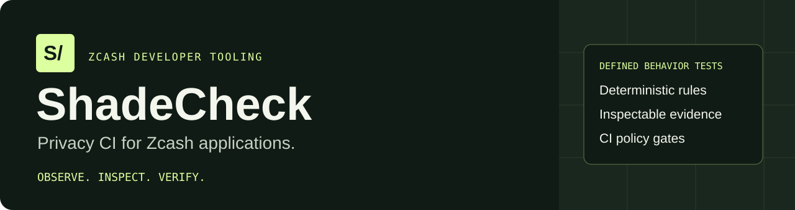
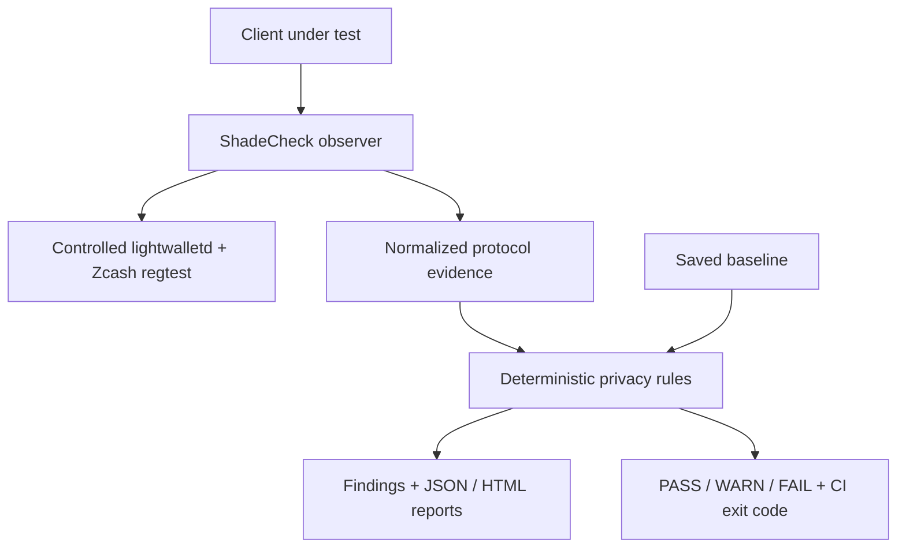

<p align="center">
  
</p>

<p align="center">
  <a href="https://shade-check-nu.vercel.app/"></a>
  <a href="LICENSE"></a>
  <a href="docs/acceptance.md"></a>
</p>

<p align="center">
  <a href="https://shade-check-nu.vercel.app/"><strong>Open demo</strong></a> ·
  <a href="#run-the-real-system">Run locally</a> ·
  <a href="docs/threat-model.md">Threat model</a> ·
  <a href="docs/zingo-integration.md">Zingo integration</a> ·
  <a href="https://github.com/0xaje/ShadeCheck-/actions">CI evidence</a>
</p>

# ShadeCheck

**Privacy CI for Zcash applications. Built for ZECATHON · Core &amp; Tooling.**

A transaction can be correctly shielded while application requests still expose clues. ShadeCheck helps Zcash wallet and SDK developers catch defined privacy-sensitive behaviors before release: capture real protocol events, evaluate deterministic rules, inspect the evidence, and compare against a baseline.

> Passing ShadeCheck means no violation of the tested rule was observed in the executed environment with the required coverage. **It does not establish anonymity.**

## Start here

| What you want to do | Where to go |
| --- | --- |
| Explore findings immediately | [Open the public evidence viewer](https://shade-check-nu.vercel.app/) — saved real regtest reports; no setup required |
| Execute fresh tests | [Run locally](#run-the-real-system) with Python and Docker |
| Check what was actually verified | [Acceptance audit](docs/acceptance.md) and [validation record](docs/RELEASE_VALIDATION.md) |
| Inspect an independent client integration | [Pinned, unmodified Zingo synchronization](docs/zingo-integration.md) and [recorded artifacts](examples/zingo/README.md) |
| Understand the limits | [Threat model](docs/threat-model.md) and [rule boundaries](#five-initial-rule-families) |

<!-- Add the ShadeCheck-specific YouTube thumbnail/link here once its URL is supplied. Do not reuse another project's video. -->

## What the demo proves

- **Real controlled backend:** a local Zcash regtest node and lightwalletd, with actual signed transparent and Sapling transactions in the native-wallet scenarios.
- **Evidence-backed findings:** recorded RPC events support each finding; JSON and HTML reports are available for inspection.
- **Behavior comparisons:** deliberately weak flows fail the declared policy; controlled alternatives change selected results.
- **Regression gates:** saved baselines identify new failures, behavior categories, and increased severity; strict policy failures return nonzero exit codes.
- **Independent synchronization:** a separate unmodified, pinned Zingo client completed direct and observed scanning, with 101 canonical blocks checked and 124 recorded events. This integration covers synchronization, not Zingo payments or broadcast.

The public website displays recorded evidence. Fresh execution runs on the developer's computer through the CLI or optional local dashboard runner.



## Evidence privacy and useful policies

Fresh recordings use per-run keyed session identifiers and omit arbitrary broadcast response text. Local evidence files are private by default on POSIX; metadata remains sensitive and public export requires explicit acknowledgement. See [evidence handling](docs/evidence-privacy.md).

Select requirements that match your actual observer and workflow. A finding is not automatically a newly discovered vulnerability. See [rule applicability and developer actions](docs/rule-applicability.md).

## Run the real system

Requirements: Git, Python 3.11+, and Docker Desktop with Linux containers (or Docker Engine/Compose on Linux). Start Docker and require both Client and Server in `docker version`.

From the cloned repository in Windows PowerShell:

```powershell
py -m venv .venv
.\.venv\Scripts\python.exe -m pip install .
.\.venv\Scripts\python.exe -m shadecheck.cli doctor
.\.venv\Scripts\python.exe scripts/acceptance.py
```

Linux/macOS Python commands:

```sh
python3 -m venv .venv
. .venv/bin/activate
python -m pip install .
python -m shadecheck.cli doctor
python scripts/acceptance.py
```

The command starts a dedicated regtest node and pinned lightwalletd source, constructs real signed transparent and Sapling transactions, captures actual events, runs all five rule families, and verifies expected policy outcomes. The first build/proof construction takes several minutes. Existing developer-owned local wallet/chain volumes are preserved; do not run two suites concurrently.

Acceptance PASS means the checks produced their required outcomes. Aggregate privacy remains FAIL because deliberately weak flows and broadcast linkage are exercised. No fabricated runtime events or backend acceptance are used.

[Setup and troubleshooting](docs/regtest-setup.md) · [Acceptance audit](docs/acceptance.md) · [Threat model](docs/threat-model.md)

## Inspect a recorded real run

```powershell
.\.venv\Scripts\shadecheck.exe demo
.\.venv\Scripts\shadecheck.exe dashboard
```

Open http://127.0.0.1:9070. Both commands validate the newest completed out/acceptance run. `demo --suite PATH` gives a **recorded evidence walkthrough**, not new network execution. With no saved evidence it fails clearly. It never invents a transaction or a PASS result.

The dashboard shows report filters, findings, source events, baseline changes, rule coverage/limits, and byte-exact downloads. Large integers are displayed as decimal strings to preserve nanosecond precision; original downloads retain their exact numeric types. No Node installation is needed for the CLI/dashboard. Optional `npm run dev`, `npm run demo`, and `npm test` launch the same Python commands on Windows and POSIX systems.

To run actual controlled tests from the local dashboard, use `shadecheck dashboard --enable-runner --project .` with Docker running. It launches fixed sync/acceptance drivers, shows actual logs/status, validates the new reports, and exposes their downloads. No arbitrary scan targets or shell commands are accepted. Default and public static views remain recorded-evidence viewers.

[Dashboard guide](docs/dashboard.md)

## Current-release wallet integration

The [Zebra/Zaino funded-wallet gate](docs/modern-wallet.md) targets the pinned current Zingo release with an explicit upstream local transport test feature. Its workflow must verify funding, shielding, sending, receipt and strict SC-002 evidence before a completed gate is claimed. See its exact pins, coverage and execution status; the older five-family regression backend remains a separate compatibility target.

## Five initial rule families

| Rule | Implemented test | Boundary |
| --- | --- | --- |
| SC-001 | Block-range size/alignment against an explicit policy | Does not infer wallet birthday/history or cover timing fingerprints |
| SC-002 | Broadcast connection-to-payload association; HIGH adds accepted submission and exact mempool bytes | A connection is not a person; shielding does not remove broadcast linkage |
| SC-003 | Non-empty proper subset of IDs from a delivered multi-transaction compact block | Delivery/retrieval does not establish ownership or internal wallet processing |
| SC-004 | Explicit transparent recipient selection/execution under a shielded requirement | Trusted local adapter; automatic Unified Address fallback is not implemented |
| SC-005 | New failures, behavior categories, and severity increases against a compatible baseline | Stronger observation can increase severity without a code change |

[SC-001](docs/sc001.md) · [SC-002](docs/threat-model.md) · [SC-003](docs/sc003.md) · [SC-004](docs/sc004.md) · [SC-005](docs/sc005.md)

The proxy records rule-specific evidence for GetLatestBlock, GetBlockRange, GetTransaction, SendTransaction, and GetMempoolStream. Additional RPCs in the vendored protocol schema are forwarded with compatibility-only fingerprints and sizes; unknown methods remain UNIMPLEMENTED. Forwarding does not imply privacy rule coverage or universal wallet compatibility. See the [pinned independent Zingo CLI integration](docs/zingo-integration.md) for its real-execution gate and limitations.

**Independent-client gate verified:** unmodified Zingo CLI from zingolib release
`zingolib_v3.0.1` completed direct and observed regtest scanning. The run checked
101 canonical blocks and captured 124 events. See [real CI](https://github.com/0xaje/ShadeCheck-/actions/runs/39599061669)
and [recorded evidence](examples/zingo/README.md). Coverage is fresh unfunded
wallet synchronization under a declared SC-001 policy; this is not current-version
production validation, all-wallet support, adoption, endorsement, or an anonymity claim.


## Evaluate your captured evidence in CI

Your integration test must first exercise its client through the ShadeCheck observer and save actual events. The Action does not automatically inspect a wallet's source code or run an application merely because it is installed.

```yaml
- uses: actions/checkout@v4
# Run your integration test through the observer and capture events.jsonl first.
- name: Evaluate captured broadcast evidence
  uses: 0xaje/ShadeCheck-@main # Pin a reviewed release commit for reproducible use.
  with:
    events: out/client/events.jsonl
    rules: SC-002
    policy: strict
    output-dir: out/privacy-gate
- uses: actions/upload-artifact@v4
  if: always()
  with:
    name: privacy-evidence
    path: out/privacy-gate/
```

For SC-001/SC-004 supply `config`; for comparisons supply `baseline` with compatible rules/policies. The Action defaults to **no source** and exits 2 unless exactly one explicit source is supplied. A fixture is available only as explicitly selected protocol conformance input; it is not real-backend acceptance or application privacy evidence.

Strict findings return 1. Invalid execution or strict missing coverage returns 2. Configure the job as a required repository check to enforce merge restrictions. A PASS does not automatically approve or merge a pull request. The real acceptance workflow exercises the Action on actual aligned and narrow traces and requires exact success/failure outcomes. The separate fixture workflow asserts its expected rejection instead of ignoring errors.

## Baselines and reports

```sh
shadecheck test --events events.jsonl --rules SC-002 --output out/report.json
shadecheck report --format json
shadecheck report --format html --output out/report.html
shadecheck report --format markdown
shadecheck baseline save --events events.jsonl --input out/report.json --output baseline.json
shadecheck test --events new-events.jsonl --rules SC-002 --baseline baseline.json
shadecheck explain SC-003
```

Baselines include the full validated trace and recomputed result. Existing baselines are not silently overwritten; known strict failures remain failures. Evidence SHA-256 values are fingerprints, not Zcash transaction IDs. Hash chains detect inconsistent editing; they are not signatures and do not prevent a malicious author rewriting the whole trace.

## Public deployment and judging

The public site is a **recorded real-regtest evidence viewer**. It must be exported from a validated acceptance directory, with its source CI run and commit. It does not execute a scan when someone changes a tab.

```sh
python scripts/export_site.py --acknowledge-public-evidence --suite out/acceptance/RUN --output public --source-run-url https://github.com/0xaje/ShadeCheck-/actions/runs/RUN_ID --source-commit FULL_40_CHARACTER_SHA
```

Vercel serves the committed `public` directory using vercel.json; `/api/data` maps to generated data and `/download/ID` maps to original artifact bytes. Export refuses an existing output directory. The CI workflow exports `out/site` as a reproducible deployment artifact. Runtime keys/credentials are never required to view recorded evidence.

[Submission and two-minute video guide](docs/HACKATHON_PITCH.md) · [Deploy/reproduction guide](docs/submission.md)

## Verified execution records

[Run 39577173119](https://github.com/0xaje/ShadeCheck-/actions/runs/39577173119) is green at source commit `c3ce35f93979eae57fa91c394be2bf7ced3d3e1a`: 37 unit checks, actual Zcash acceptance, real positive/negative consumer Action gates, installed-wheel verification, local and static Chrome/mobile checks, and an actual dashboard-triggered sync job. Its 24 reports and 112 hashed acceptance artifacts were independently revalidated. The committed public snapshot contains those exact reports, downloadable artifacts, and source provenance; it is recorded evidence, not a live scan.

[Validation record](docs/RELEASE_VALIDATION.md)

## Verification and scope

```sh
python -m unittest discover -s tests -v
python scripts/acceptance.py --verify out/acceptance/RUN
```

Unit/conformance fixtures are explicitly separated from real runtime evidence. Node and wallet-adapter records depend on trusted local test components. Spending keys stay in developer-owned local wallet volumes. Only dedicated regtest services are used; no arbitrary network scanning or production privacy guarantee is offered.

Node release and lightwalletd source revision are pinned; upstream base-image tags/package repositories may change. Actual image identities are recorded; builds are not claimed byte-identical or fully hermetic.

## License and attribution

ShadeCheck's original code is released under the [MIT License](LICENSE), copyright © 2026 Aje Oluwaseun Isaac ([@0xaje](https://github.com/0xaje)).

[THIRD_PARTY_LICENSE](THIRD_PARTY_LICENSE) contains Electric Coin Company's MIT notice for vendored lightwalletd protocol material. It is an upstream attribution notice, not a second project license or a duplicate to delete. See [third-party attribution](docs/third-party-attribution.md) and [fixture provenance](fixtures/PROVENANCE.md).

Built for [ZECATHON](https://thezecathon.com/), **Core & Tooling**. Zcash and Zingo names identify the ecosystem and tested upstream software; no endorsement is implied.
